# 记忆回廊 · 女巫牌阵（单窗口嵌套版 v3.0）

一条 **2520 米长的阴森 3D 长廊**：褪色原木墙、潮湿石砖、破旧昏黄旧灯、符纸/枯骨/垂链/破布。走到中段（约 z=1260）时雾会越来越浓，直到看不清前路，然后弹出一张**女巫契约图**；点击图片，**同一个 Godot 窗口**里直接打开《记忆翻牌》——不再另外启动一个 Godot 进程，也没有 UDP、窗口最小化或黑屏切换。

> 全部使用 **Godot 4.7.2 + GDScript**。长廊与翻牌游戏现在在**同一个工程、同一个主场景树、同一个窗口**里运行；翻牌游戏的代码与素材已复制进 `memory_game/`。

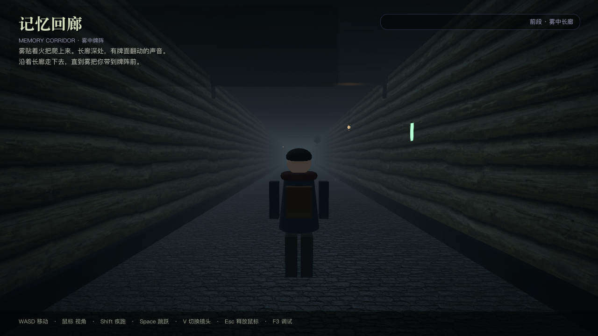

## 一眼看懂

| 项 | 内容 |
| --- | --- |
| 项目文件夹 | `/Users/chenzhengxin/地铁跑酷/corridor_event` |
| 引擎 | Godot 4.7.2，GL Compatibility |
| 长廊长度 | **2520 米**；步行 4.2 m/s，走完约 **600 秒（10 分钟）** |
| 女巫触发点 | z≈1260（约一半路程），触发区**完全隐形**，走进去自动开始 |
| 触发表现 | 雾逐渐变浓到 0.38 → 弹出契约图 → 点击图片进入翻牌 |
| 翻牌游戏 | 同进程 `SubViewport` 嵌入；**玩家在游戏大厅自己选 2×3 / 3×4 / 4×5** |
| 返回 | 一局结束（胜/负）→ **自动淡出回长廊**，不显示翻牌自己的结算页；雾恢复，按胜负给刻印。中途退出用 Esc/×，并按失败结算负面刻印 |
| 尽头 | z≈2512 结局文本触发区，中央约 5.8×4.2 米预留空间 |
| 对话 | 触发前**没有任何女巫台词/倒计时**，只有一张契约图 |

## 30 秒跑起来

```bash
"$HOME/Downloads/Godot.app/Contents/MacOS/Godot" --path "$HOME/地铁跑酷/corridor_event"
```

或者 Godot Project Manager：**Import → `corridor_event/project.godot` → F5**。

首次打开会导入长廊贴图、雨雾贴图、女巫契约图、翻牌卡面等资源，约 30–60 秒。

## 操作

| 按键 | 功能 |
| --- | --- |
| `W A S D` | 相机相对移动（步速 4.2 m/s，按住 Shift 6.8） |
| 鼠标 | 第三人称/第一人称视角 |
| `Shift` | 疾跑 |
| `Space` | 跳跃 |
| `V` | 第一/第三人称 |
| `Esc` | 释放鼠标；在翻牌游戏内=返回长廊 |
| `E` | 调试用：站在牌阵触发区再次弹出契约图 |
| `F3` | 调试信息（状态、坐标、雾密度、试炼结果、嵌入状态） |

> 触发区没有“按 E 入局”提示。默认走进去就自动触发；`E` 仅供调试/重复体验。

## 体验流程（对应 12 张截图）

### 1. 长廊起点


灰蓝浓雾、昏暗暖黄旧灯、远处若隐若现的紫罗兰牌阵。HUD 只显示环境信息，没有任何女巫对白。

### 2. 长走廊

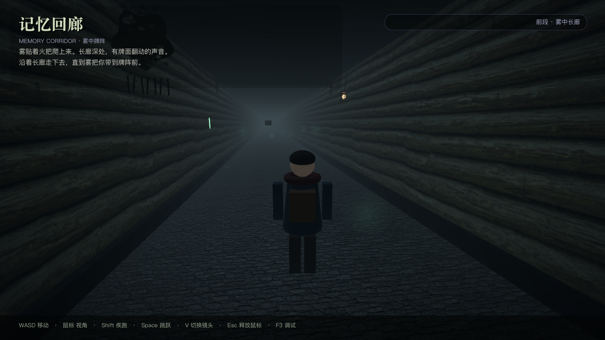

一条 2520 米的直廊，墙/地面 UV 按米数循环；沿途约 1 盏旧灯/28 米，符纸、枯骨、垂链按 40–110 米间隔出现，整体低密度但足够阴森。

### 3. 接近中段：雾越来越浓

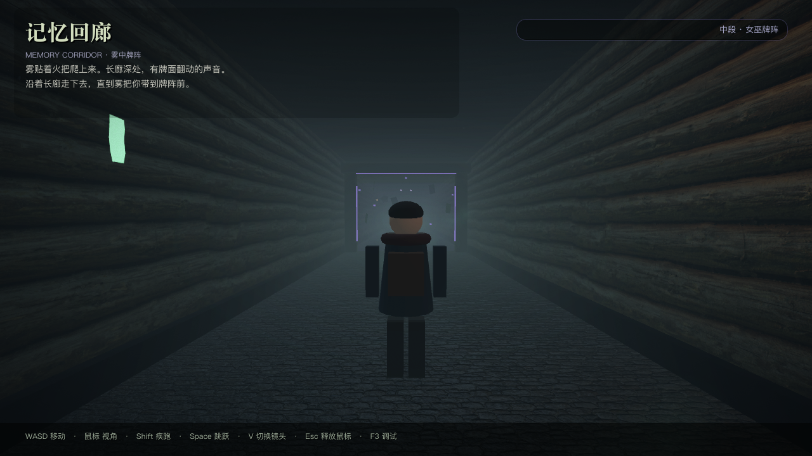

z≈1244 起雾开始变浓，z≈1259 达到走路阶段峰值（0.22）。走到触发区附近时，前路几乎只剩轮廓。

### 4. 触发区：只弹一张契约图

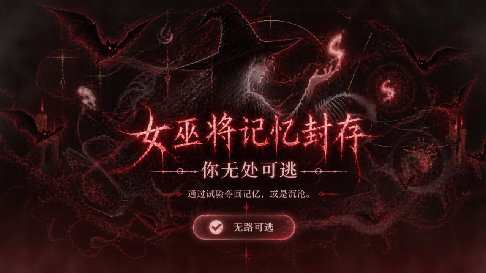

进入隐形触发区后：
- 移动被冻结，雾被推到 **0.38**；
- 等待 0.9 秒让雾压满；
- 画面淡出，弹出你指定的女巫契约图；
- **没有一句台词，没有倒计时**，整张图都可以点。

### 5. 同一个窗口里打开《记忆翻牌》

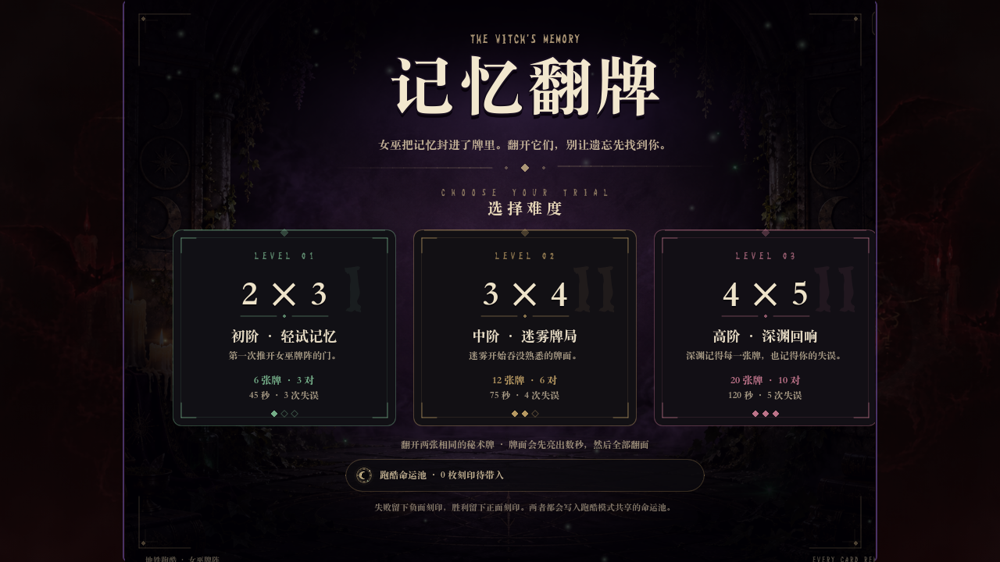

点击契约图后，同一窗口淡入翻牌游戏大厅。大厅提供三档难度：

- **2×3 初阶 · 轻试记忆**（3 对，45 秒）
- **3×4 中阶 · 迷雾牌局**（6 对，75 秒）
- **4×5 高阶 · 深渊回响**（10 对，120 秒）

**没有固定难度**，玩家点哪张卡就玩哪一档。

### 6. 开始翻牌

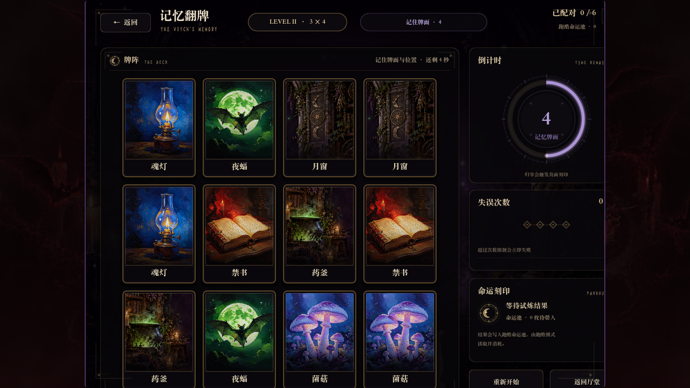

翻牌游戏已经是这个工程的一部分（`memory_game/`），运行在同一个窗口的 SubViewport 中。左右两侧留白用同一张女巫契约图做暗色底，并加了细边框，视觉上像长廊里的一面“女巫之镜”，而不是另一个程序。

### 7. 一局结束 → 自动回到长廊 → 雾恢复 → 刻印

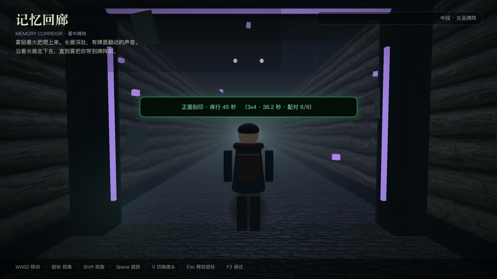

**一局结束（无论成功还是失败）会自动回廊**，不需要玩家再点“返回”：
- 翻牌游戏的 `run_finished` 一发出，立刻隐藏它自己的“TRIAL COMPLETE / TRIAL FAILED”结算页；
- 淡出，释放嵌入场景，重新显示长廊 3D 与 HUD；
- 雾平滑恢复常态（0.038，模糊但看得清前方）；
- 胜利给**正面刻印 · 疾行 ×1.18/45s**，失败给**负面刻印 · 滞步 ×0.82/45s**，HUD 显示刻印条，并给一条短提示“已回到长廊”；
- `Esc`/右上角 `×` 用于**中途退出**；中途退出按**失败**处理，施加负面刻印。

### 8. 继续走向尽头

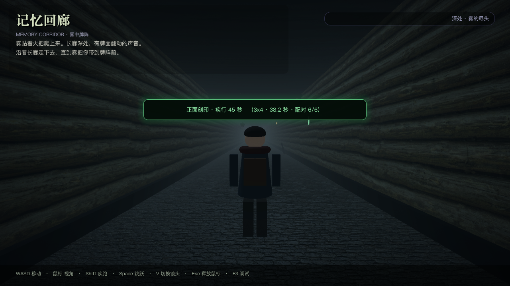

从 z=1260 继续走到 z=2512，约 5 分钟。雾在 z≈1272 之后恢复正常，深处仍然昏暗、雾蒙蒙。

### 9. 尽头：游戏结束文本

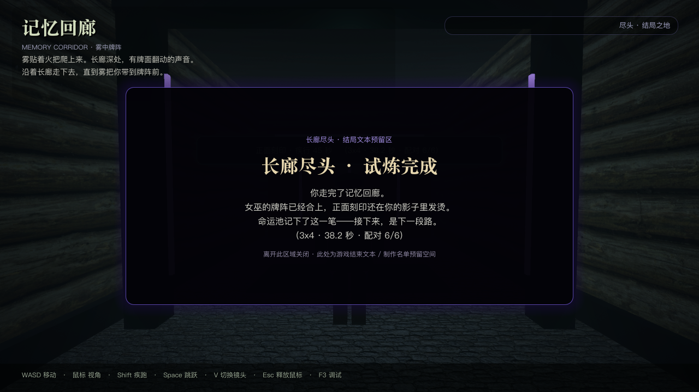

尽头 `EndingZone`（z≈2512）触发结局面板：
- 按最近一次试炼结果显示“试炼完成 / 试炼未竟 / 雾的源头”；
- 中央约 **5.8 × 4.2 米**空地不摆放符纸/枯骨/锁链，预留给后续结局 CG、制作名单或 3D 字幕；
- 离开触发区自动收起。

### 10. 第一人称 / 调试

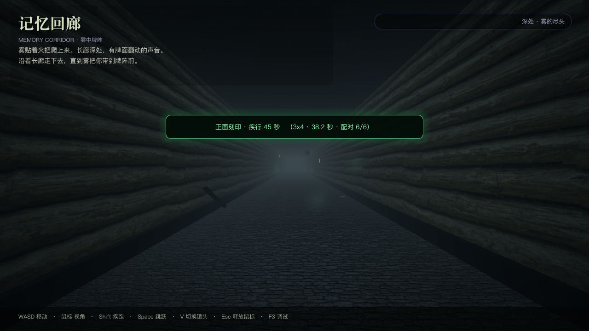

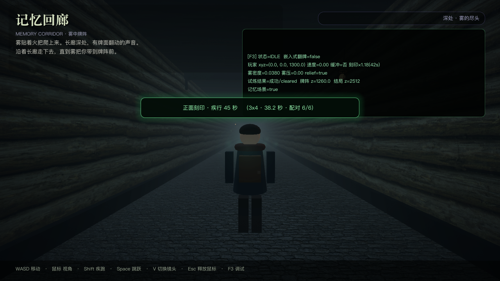

`F3` 可看状态、坐标、雾密度、试炼结果与嵌入状态；维护时很有用。

## 架构：为什么不再启动第二个 Godot

```text
Main (Node3D)
├─ WorldEnvironment / 长走廊 / 牌阵 / 结局区 / Player / HUD
├─ PactLayer (CanvasLayer)         ← 女巫契约图
├─ FadeLayer (CanvasLayer)         ← 统一黑场过渡
└─ EmbeddedMemoryLayer (CanvasLayer)
   └─ MemoryRoot
      ├─ 暗色女巫背景 + 细边框
      └─ SubViewportContainer (960×720)
         └─ SubViewport (1024×768)
            └─ MemoryGame (Control, 直接实例化)
```

- 没有 `OS.create_process`、没有 UDP、没有窗口最小化/恢复；
- 翻牌游戏以 **`MemoryGame` 场景实例**嵌进同一棵场景树；
- 进入/返回都用同一个 `FadeLayer` 做 0.5–0.8 秒淡入淡出；
- 翻牌游戏运行时隐藏长廊 3D，减少 GPU 负担；返回时恢复。

## 地图 / 时间

| 项 | 数值 |
| --- | --- |
| 总长 | 2520 m |
| 步速 | 4.2 m/s |
| 纯步行时间 | **600 s = 10 分钟** |
| 牌阵 | z=1260（约 5 分钟处） |
| 结局区 | z=2512 |
| 地板碰撞 | Box(6, 0.4, 2520) |
| 左右墙碰撞 | Box(0.4, 4.4, 2520)，内表面 x=±3.0 |
| 生成节点 | 约 1650 个（含约 90 盏旧灯） |

想改成别的时长：改 `tools/build_corridor.gd` 的 `LENGTH`、`Z_END`、`Z_CENTER`、`ZONE_Z`、`ENDING_Z`，再重新生成 `main.tscn`。**三者必须同步**，否则墙/碰撞/触发区会错位。

## 测试

```bash
cd "$HOME/地铁跑酷/corridor_event"
bash tools/run_tests.sh
```

当前覆盖 **55 项检查**：
- 2520 米结构、地板/墙体碰撞、玩家落地/撞墙；
- 触发区无标记、自动进入契约状态、无对白、雾 >0.3；
- 点击契约图后同进程打开嵌入式翻牌；
- 翻牌大厅显示 3 档难度、`_level_id` 为空（无固定难度），玩家可选择；
- 胜利/失败结果回到长廊分别施加 ×1.18 / ×0.82 刻印；
- 结束后雾恢复到常态；
- 尽头结局触发区显示/收起；
- 人物模型接入 API。

> 这是**开发工程**；打包时要把 `memory_game/`、`assets/ui/witch_pact.png`、`output/witch-ui/`、`hakidame.TTF` 一起导出。详见 [docs/02_维护手册.md](docs/02_维护手册.md)。

## 目录

```text
corridor_event/
├─ project.godot                # 单工程；唯一 Autoload = RunBuffs
├─ assets/                      # 地板/墙/氛围/女巫契约图
├─ materials/ shaders/          # 长廊材质与暗角
├─ memory_game/                 # 复制进来的《记忆翻牌》场景 + 脚本 + 卡面
├─ output/witch-ui/             # 翻牌大厅背景图（随工程导出）
├─ scenes/main.tscn             # 由生成器生成
├─ scenes/player.tscn buffer_zone.tscn ending_zone.tscn
├─ scripts/main.gd              # 长廊 + 契约图 + 嵌入/返回 + 刻印
├─ scripts/corridor/            # 牌阵/结局区/氛围
├─ scripts/ui/event_hud.gd      # HUD（对白/倒计时节点已不参与流程）
├─ tools/build_corridor.gd      # 2520m 地图生成器
├─ tools/capture_screenshots.gd # 12 张截图
├─ tools/run_tests.sh
├─ tests/test_corridor.gd/.tscn # 55 项无头验收
└─ docs/                        # 制作过程、维护手册、模型接入、嵌入说明、验收
```

## 文档

- [01 地图制作全过程](docs/01_地图制作全过程.md)
- [02 维护手册](docs/02_维护手册.md)
- [03 人物模型接入通道](docs/03_人物模型接入通道.md)
- [04 单窗口嵌套与翻牌接入](docs/04_单窗口嵌套与翻牌接入.md)
- [05 测试与验收记录](docs/05_测试与验收记录.md)

## 已知边界

- 长廊是直廊 + 程序化重复装饰；2520 米主要是“走”的体验，不是每米都有独特事件。
- 翻牌游戏按 1024×768 设计，嵌入到 1280×720 时左右各留 160 px 暗色女巫底，作为“镜框”；没有拉伸变形。
- 翻牌游戏内的难度/卡面/时间在 `memory_game/scripts/game_config.gd` 修改；改完不用改长廊。
- 目标工程 `/Users/chenzhengxin/subway-runner` 中的旧 GameLink/UDP 方案已不再被长廊调用；长廊使用的是复制进本工程的 `memory_game/`。
