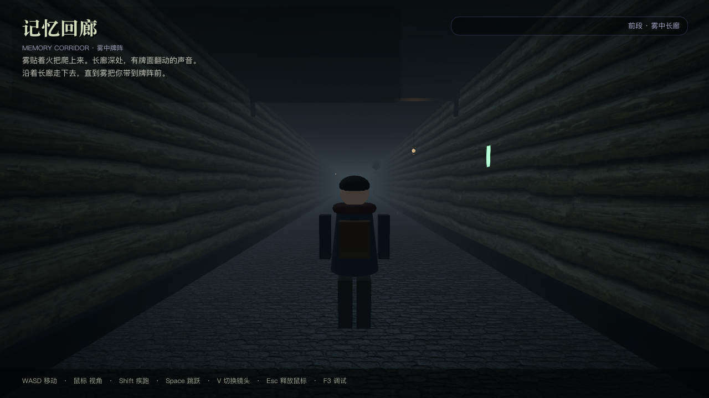

# 01 · 地图制作全过程（v3.0 单窗口嵌套版）

> 记录这条 **2520 米阴森长廊 + 嵌入式《记忆翻牌》** 从零到可玩的完整制作过程：素材、材质、几何、碰撞、长地图生成、动态雾、隐形触发区、契约图、单窗口嵌套、返回过渡、结局区、截图与验收。
>
> 日常维护看 [02_维护手册.md](02_维护手册.md)；换人物模型看 [03_人物模型接入通道.md](03_人物模型接入通道.md)；嵌套细节看 [04_单窗口嵌套与翻牌接入.md](04_单窗口嵌套与翻牌接入.md)。

---

## 0. 本次目标

| # | 要求 | 实现 |
| --- | --- | --- |
| 1 | 3D 长廊、地板/墙壁碰撞 | 2520 × 6 × 4.4 m，地板/左右墙/天花/前后封墙均有 Box 碰撞 |
| 2 | 地板用 `wall-tile-seamless.zip` | 石砖贴图 + 法线，1 m/循环 |
| 3 | 墙壁用 `wooden-log-wall-seamless-texture.zip` | 4K 降 2048 + normal/roughness/AO，4 m/循环 |
| 4 | 中段事件 | z≈1260 隐形触发区，走进去自动开始 |
| 5 | 触发不要突然 | z≈1244 起雾逐渐变浓，触发瞬间密度 0.38，几乎看不清路 |
| 6 | **删掉女巫对白** | 触发后只弹一张契约图，无台词、无倒计时、无“按 E 入局”提示 |
| 7 | 点图片进翻牌 | 整张图可点；点击后同窗口淡入《记忆翻牌》 |
| 8 | **不能另开 Godot 进程** | 翻牌场景复制进本工程，用 SubViewport 嵌入同一窗口/同一进程 |
| 9 | 翻牌难度由玩家选 | 进入翻牌游戏大厅，2×3 / 3×4 / 4×5 三档由玩家点击选择 |
| 10 | 进入后不要再加操作 | 长廊 HUD/对白全部隐藏；只保留翻牌游戏自己的 UI 与返回入口 |
| 11 | 两个游戏要像一体 | 统一黑场过渡、契约图做镜框、同窗口、返回时雾恢复与刻印反馈 |
| 12 | 地图走完约 10 分钟 | 2520 m ÷ 4.2 m/s = 600 s（纯步行） |
| 13 | 长廊尽头放结束文本并留空间 | z≈2512 的 `EndingZone`，中央 5.8×4.2 m 清空道具 |
| 14 | buff/debuff 仍保留 | 胜：疾行 ×1.18/45s；负：滞步 ×0.82/45s；HUD 刻印条 |
| 15 | 测试/文档 | 55 项无头验收、12 张截图、全新制作过程与维护手册 |

最终效果：



---

## 1. 工程结构

```text
corridor_event/
├─ project.godot                  # 单工程；唯一 Autoload = RunBuffs
├─ assets/floor|wall|fx|ui/       # 长廊贴图、氛围贴图、女巫契约图
├─ materials/                     # 长廊材质
├─ shaders/eerie_vignette        # 暗角+噪点
├─ memory_game/                   # 从 subway-runner 复制进来的翻牌游戏
│  ├─ memory_game.tscn
│  ├─ scripts/                    # memory_game.gd / game_config.gd / run_buffs.gd ...
│  └─ art/                        # 卡面、medallion
├─ output/witch-ui/               # 翻牌大厅三张背景图（原工程依赖）
├─ hakidame.TTF                   # 翻牌游戏字体
├─ scenes/main.tscn               # 生成物，不手改
├─ scenes/player.tscn
├─ scenes/buffer_zone.tscn        # 隐形触发区 + 记忆之门
├─ scenes/ending_zone.tscn        # 尽头结局文本区
├─ scripts/main.gd                # 长廊 + 契约图 + 嵌套/返回 + 刻印
├─ scripts/corridor/              # buffer_zone / ending_zone / atmosphere
├─ scripts/ui/event_hud.gd        # HUD（旧对白/倒计时节点已不参与流程）
├─ tools/build_corridor.gd        # 2520m 地图生成器
├─ tools/capture_screenshots.gd   # 12 张截图
├─ tools/run_tests.sh
└─ tests/test_corridor.gd/.tscn   # 55 项验收
```

`project.godot` 关键项：

```ini
[autoload]
RunBuffs="*res://memory_game/scripts/run_buffs.gd"

[display]
window/size/viewport_width=1280
window/size/viewport_height=720
window/stretch/mode="canvas_items"
window/stretch/aspect="expand"

[rendering]
renderer/rendering_method="gl_compatibility"
```

> 只有一个 Autoload：`RunBuffs`。没有 EventBridge、没有 GameLink、没有 UDP。

---

## 2. 素材与导入

### 2.1 长廊素材

| 素材 | 来源 | 处理 |
| --- | --- | --- |
| 地板 albedo/法线 | `wall-tile-seamless.zip` | 1024 PNG，VRAM Compressed + mipmap |
| 墙壁 albedo/normal/roughness/AO | `wooden-log-wall-seamless-texture.zip` | 4096 → 2048（`sips -Z 2048`） |
| 雾/卡背/符纸/破布 | `tools/generate_fx_textures.py` | Pillow 程序化生成 256/512 PNG |
| 女巫契约图 | 用户提供的 1848×851 PNG | 复制到 `assets/ui/witch_pact.png` |

### 2.2 翻牌游戏素材（同工程必需）

从 `/Users/chenzhengxin/subway-runner` 复制：

- `memory_game/scripts/`（去掉 `game_link.gd`，因为不再跨进程）
- `memory_game/art/cards/`、`memory_game/art/ui/`
- `memory_game/memory_game.tscn`
- `output/witch-ui/background-*.png`
- `hakidame.TTF`

翻牌游戏原本按 **1024×768** 排布，所以嵌入时用 **原尺寸 SubViewport**，再等比缩放到窗口高度，避免拉伸字体与卡面。

### 2.3 导入参数

| 参数 | 值 | 原因 |
| --- | --- | --- |
| `compress/mode` | 2（VRAM Compressed） | 3D/2D 实时采样，省显存 |
| `mipmaps/generate` | true | 远处墙/地面不闪烁 |
| `compress/normal_map` | 1 | 法线贴图必须按法线解码 |

---

## 3. 长地图：2520 米怎么生成

### 3.1 常量

`tools/build_corridor.gd`：

```gdscript
const LENGTH := 2520.0     # 4.2 m/s × 600 s
const WIDTH := 6.0
const HEIGHT := 4.4
const Z_START := -2.0
const Z_END := 2518.0
const Z_CENTER := 1258.0
const ZONE_Z := 1260.0     # 女巫牌阵（约 5 分钟处）
const ENDING_Z := 2512.0   # 结局文本区
const PLAYER_Z := 1.6
```

### 3.2 几何与碰撞

| 节点 | 形状/尺寸 | 位置 | 说明 |
| --- | --- | --- | --- |
| Floor | PlaneMesh(6, 2520) | (0,0,1258) | UV 1 m/循环 |
| FloorCollision | Box(6, 0.4, 2520) | (0,-0.2,1258) | 顶面 y=0 |
| RightWall / LeftWall | QuadMesh(2520, 4.4) | x=±3 | 单面朝内，UV 4 m/循环 |
| 左右墙碰撞 | Box(0.4, 4.4, 2520) | x=±3.2 | 内表面 x=±3.0 |
| Ceiling / 碰撞 | Quad/Ceiling Box(6,0.3,2520) | y=4.4/4.55 | |
| Back/Front 封墙 | Box(6,4.4,0.4) | z=-2.2 / 2518.2 | |
| EndDoorCollision | Box(5.4,3.6,0.35) | z≈2517.65 | 尽头封印门 |

材质 UV 必须同步放大，否则贴图会拉成一条：

| 材质 | `uv1_scale` |
| --- | --- |
| `floor_stone.tres` | (6, 2520, 1) |
| `wall_log.tres` | (630, 1.1, 1) |
| `ceiling_wood.tres` | (1.5, 630, 1) |
| `wall_log_end.tres` | (1.5, 1.1, 1)（6 m 短墙不变） |

### 3.3 程序化装饰

不手摆几千个节点，而是按间距循环：

| 装饰 | 间距 | 数量级 |
| --- | --- | --- |
| 旧灯 | 28 m | ~90 |
| 横梁 | 24 m | ~100 |
| 符纸 | 40 m | ~60 |
| 苔藓 | 50 m | ~50×2 |
| 枯骨 | 37 m | ~65 |
| 垂链 | 110 m | ~22 |
| 破布/断木板 | 96/108 m | ~25/23 |
| 冷尘埃/贴地雾 | 5 个区段 | 5+5 个粒子系统 |
| 雾帘 | 每 400 m + 牌阵附近 | ~12 |

生成结果约 **1650 个节点**。`牌阵/结局区附近 ±6~12 m 会跳过装饰`，保持两处干净。

> 想加密度：改 `LANTERN_STEP` 等常量即可；不要手改 `main.tscn`。

---

## 4. 氛围：雾、旧灯、破烂道具

### 4.1 环境

`_build_environment()`：

```gdscript
env.fog_density = 0.038
env.fog_light_color = Color(0.16, 0.2, 0.22)
env.fog_light_energy = 1.5
env.fog_aerial_perspective = 0.5
env.adjustment_saturation = 0.72
env.adjustment_contrast = 1.06
```

### 4.2 动态雾

`scripts/main.gd` 的“动态雾”导出组：

| 参数 | 默认 | 说明 |
| --- | --- | --- |
| `fog_ramp_start_z` | 1244 | 开始起雾（牌阵中心 -16） |
| `fog_peak_z` | 1259 | 走路阶段峰值 |
| `fog_hold_end_z` | 1262 | 峰值保持到 |
| `fog_clear_end_z` | 1272 | 恢复常态 |
| `fog_dense_density` | 0.22 | 走路阶段峰值 |
| `fog_event_density` | 0.38 | 契约图/翻牌期间（几乎看不清） |
| `fog_follow_speed` | 1.8 | 变浓速度 |
| `fog_relief_speed` | 1.1 | 恢复速度 |
| `fog_relief_duration_sec` | 60 | 返回后保持常态的时间 |

曲线：18→32 的 smoothstep 上升、32→36 保持、36→44 回落；这里整体平移到 1260 附近。事件结束后 `_set_fog_relief()` 把目标改回 0.038；玩家仍站在牌阵雾区时会一直维持常态，离开雾区后（或 60 秒后已离开）才恢复按 Z 计算，防止站在牌阵里又被浓雾埋住。

### 4.3 旧灯

- 暖黄 `(1.0, 0.68, 0.36)`，能量 0.55–1.0；
- 部分歪挂、断笼条、`index%17==5` 是将熄灯；
- `atmosphere.gd` 按组做闪烁/摆动/雾帘漂移；
- 全走廊约 90 盏，但雾和远裁剪让画面不炸。

### 4.4 破烂道具

符纸、苔藓、枯骨、垂链、破布、断木板、贴地雾、冷尘埃。全部低密度、低亮度，避免“骷髅主题乐园”。

---

## 5. 触发区：完全隐形

`scenes/buffer_zone.tscn`：

```text
BufferZone (Node3D @ z=1260)
├─ TriggerArea (Area3D, layer=4, mask=2) + Box(5.8, 3.2, 4.2)
├─ MemoryGate（木柱 + 拱梁 + 紫色帷幕 + 符文灯带 + 浮空卡）
├─ WitchEyes（会眨的紫罗兰眼睛）
├─ WitchCards（5 张浮空卡背）
└─ ArchCollision（两根门柱）
```

- **没有地面符文圈/紫色圆盘**：上一版的 `RuneCircle` 已删除；
- **没有 HUD 徽标/“按 E 入局”提示**；
- 地面无任何发光标记，走进去自动触发；
- 牌阵中心紫光只有 0.35，不形成光圈；
- 触发盒宽 5.8 < 6.0，玩家不能贴墙绕过；高 3.2 覆盖跳跃；深 4.2 给过渡留时间。

### 触发后的状态

```text
IDLE
 └─进入 Area → PACT
      ├─ 冻结移动、隐藏 HUD
      ├─ 0.9s 把雾压到 0.38
      ├─ 淡出 0.55s → 显示契约图
      └─ 点击整张图 → MEMORY
```

---

## 6. 女巫契约图（替代全部对白）

- 资源：`assets/ui/witch_pact.png`（用户提供的 1848×851 图）；
- 全屏 `TextureRect`，`STRETCH_KEEP_ASPECT_COVERED`，铺满 1280×720；
- `PactRoot` 是 `MOUSE_FILTER_STOP` 的全屏 Control，整张图可点；
- 同时 `_unhandled_input` 兜底：PACT 状态下鼠标左键/Enter/Space 也能进入；
- 无字幕、无倒计时、无“按任意键”提示；
- 点击后淡出，进入嵌入的翻牌游戏。

---

## 7. 单窗口嵌入《记忆翻牌》

### 7.1 场景树

```text
Main
└─ EmbeddedMemoryLayer (CanvasLayer 100)
   └─ MemoryRoot (Control)
      ├─ ColorRect（深色底）
      ├─ TextureRect（契约图做暗色边，alpha 0.22）
      ├─ Panel（紫黑细边框，像“女巫之镜”）
      └─ SubViewportContainer (960×720, stretch=true)
         └─ SubViewport (1024×768)
            └─ MemoryGame (Control, 直接 instantiate)
```

- 翻牌场景按 1024×768 原尺寸渲染，等比缩放到 720 高（960×720），左右各 160 px 用契约图做暗色边；
- `SubViewportContainer.mouse_filter=STOP`，鼠标/键盘事件由 Godot 转发给 SubViewport；
- 翻牌游戏调用 `set_embedded(true)`，出现自己的返回入口；
- 打开时不指定难度：`open_from_command({"view":"menu"})`，玩家在大厅自己选。

### 7.2 进入/返回

```text
点击契约图
  → 淡出 0.5s
  → 隐藏 3D 长廊（减少 GPU 负担）
  → 创建 EmbeddedMemoryLayer
  → 淡入 0.7s
  → 玩家在翻牌大厅选难度、游玩

一局结束（胜或负）
  → run_finished 信号
  → 立即隐藏翻牌自己的结算页
  → 淡出 0.4s
  → 释放内存场景、显示 3D/HUD
  → 雾恢复、按结果施加刻印、短提示
  → 淡入 0.8s

中途退出（Esc / ×）
  → close_requested 信号
  → 按失败结算：负面刻印（滞步×0.82/45s）
```

整个过程没有新 Godot 进程、没有 UDP、没有窗口最小化。

### 7.3 结果

`MemoryGame.run_finished(result)` 直接连到 `main.gd`：

- `success=true` → 疾行 ×1.18/45s；
- `success=false` → 滞步 ×0.82/45s；
- 翻牌游戏发出 run_finished 后，长廊立即隐藏嵌入层并回到长廊；不显示翻牌自己的结算停留页，只由长廊 HUD 显示刻印条与短提示。

---

## 8. 尽头结局文本区

`scenes/ending_zone.tscn` @ z=2512：

- Area3D(5.8, 3.2, 4.2)；
- 铁柱/拱梁取景框、低矮深色铭板、两盏紫罗兰灯球；
- 中央 5.8×4.2 m 不摆符纸/苔藓/垂链/枯骨；
- 进入时 HUD 弹出 `EndingPanel`，按最近试炼结果显示“完成/未竟/还没挑战”；
- 离开自动收起；
- `EndingTextAnchor` 预留给后续 3D 文本/制作名单。

---

## 9. 玩家与相机

```text
Player (CharacterBody3D, layer=2, mask=1)
├─ CapsuleShape3D(r=0.34, h=1.8, y=0.9)
├─ ModelRoot (PlayerModelSlot) → PlaceholderModel
└─ CameraPivot → SpringArm3D(3.4) → Camera3D(fov=70, far=220)
```

- 步速 4.2、疾跑 6.8、重力 20、起跳 5.4；
- **只旋转 ModelRoot，不旋转 Player 本体**，否则 CameraPivot 世界 yaw 会叠加两次；
- 相机 yaw=180 表示看向 +Z；
- 进入契约图/翻牌时关闭输入/视角、释放鼠标；返回后恢复并捕获鼠标。

---

## 10. HUD

`ui/event_hud.tscn`：

- 默认只显示标题/环境提示/坐标/操作；
- 旧的叙事/倒计时/连接节点保留在场景里但**不参与流程**；
- 实际用到的：刻印状态条、尽头结局面板、F3 调试、暗角噪点；
- 旧的全屏 `FadeRect` 默认黑色，`main.gd` 启动时必须 `hud.set_fade_alpha(0.0)`，否则整屏黑（本次踩过的坑）。

---

## 11. 生成器

```bash
"$HOME/Downloads/Godot.app/Contents/MacOS/Godot" --headless \
  --path "$HOME/地铁跑酷/corridor_event" \
  --script res://tools/build_corridor.gd
```

输出 `nodes=1650` 左右，保存 `scenes/main.tscn`。

原则：

1. 先游离搭树 → 挂进 SceneTree → 统一 owner → `pack()`；
2. 构建时 `Engine.set_meta("corridor_build", true)`，让 main.gd 跳过运行逻辑；
3. 改长度必须同步 `LENGTH/Z_END/Z_CENTER/ZONE_Z/ENDING_Z`，并同步材质 UV 与测试。

---

## 12. 截图（12 张）

`tools/capture_screenshots.gd`：

| 文件 | 内容 |
| --- | --- |
| 01 | 起点 |
| 02 | 长走廊 |
| 03 | 墙材近景 |
| 04 | 接近牌阵的浓雾 |
| 05 | 女巫契约图（无对白） |
| 06 | 翻牌游戏大厅（3 档难度自选） |
| 07 | 翻牌游戏 3×4 |
| 08 | 返回长廊、雾恢复、刻印条 |
| 09 | 深处 |
| 10 | 尽头结局文本 |
| 11 | 第一人称 |
| 12 | F3 调试 |

截图时会冻结玩家输入，避免系统输入让角色漂移；并在窗口前台运行。

---

## 13. 踩坑记录

1. **HUD 全屏 FadeRect 默认黑色**：新 main 接管淡入后忘了清零，导致游戏窗口全黑；必须在 `_ready` 里 `hud.set_fade_alpha(0)`。
2. **PactLayer CanvasLayer 默认隐藏**：显示时要把 `CanvasLayer.visible` 和 `PactRoot.visible` 都设 true。
3. **契约图点击**：只靠 Control `gui_input` 在窗口缩放下不够稳；`_unhandled_input` 增加全屏左键兜底。
4. **嵌入画面全屏/留白**：1024×768 场景不能硬拉成 1280×720；用 SubViewport 原尺寸 + 等比缩放 + 暗色镜框。
5. **翻牌键盘**：SubViewport 可能拿不到 Esc，宿主 `main.gd` 在 MEMORY 状态也监听 Esc 兜底。
6. **难度被写死**：不要 `open_from_command({"view":"level","level":"3x4"})`；用 `{"view":"menu"}`。
7. **长地图**：只拉长几何而不改 UV/碰撞/触发 Z，会出现贴图拉伸、墙碰撞错位、走 10 分钟到不了事件。
8. **旧跨进程桥**：EventBridge/UDP/GameLink 会重新开 Godot 进程，和“单窗口”目标冲突，已整体移除。
9. **内存游戏资源依赖**：`output/witch-ui/background-*.png`、`hakidame.TTF`、`memory_game/art` 必须一起复制，否则翻牌背景/卡面丢失。
10. **HUD 文案**：`event_hud.gd` 会在 `_ready` 覆盖 Objective 文本，改 UI 场景后还要改脚本，否则旧文案回来。
11. **截图黑屏**：先检查 HUD/主 Fade 两层全屏遮罩的 alpha，再看 3D。
12. **地图生成节点过多**：2520 m 不要沿用 64 m 的灯距（会 200+ 盏灯）；按 28 m 灯距、40–110 m 道具距生成。

---

## 14. 验收清单

- [x] 2520 m 长廊，步行约 600 秒（10 分钟）
- [x] 地板/墙/天花/尽头碰撞正确，撞墙 x=±2.659
- [x] 中段 z≈1260 触发区**无地面标记/无 HUD 提示**，进入自动开始
- [x] 触发前无女巫台词、无倒计时；只弹契约图
- [x] 点击契约图，同一进程/同一窗口嵌入《记忆翻牌》
- [x] 翻牌大厅提供 2×3 / 3×4 / 4×5，玩家自选，未固定难度
- [x] 翻牌一局结束（胜/负）自动回廊，不显示翻牌自己的结算页；中途 Esc/× 判失败并施加负面刻印
- [x] 返回后雾恢复常态，按胜负施加 ×1.18 / ×0.82 刻印
- [x] 尽头 z≈2512 结局文本触发区 + 5.8×4.2 m 预留空地
- [x] 55 项无头测试通过
- [x] 12 张文档截图
- [x] 制作过程 / 维护手册 / 模型接入 / 嵌套说明 / 验收记录全部更新

下一步：维护看 [02_维护手册.md](02_维护手册.md)。
