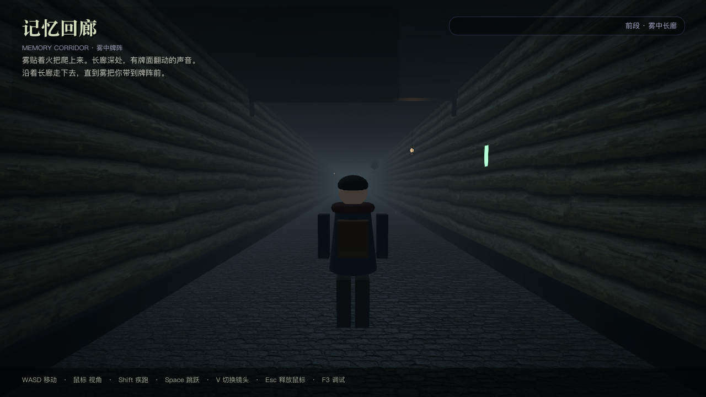

# 03 · 人物模型接入通道

> 本项目交付时**没有附带真实人物模型**：角色是一个程序化占位小人（胶囊 + 圆柱 + 方块），保证开箱能玩。
>
> 这篇文档是“把真正的人物模型接进来”的唯一官方通道。整个接入过程**不需要改事件/玩法代码**，只动模型节点与少量导出参数。



---

## 0. 先理解结构

`scenes/player.tscn`：

```text
Player (CharacterBody3D, layer=2, mask=1, 脚本 player_controller.gd)
├─ Collision (CollisionShape3D, CapsuleShape3D, radius=0.34, height=1.8, y=0.9)
├─ ModelRoot (Node3D, 脚本 player_model_slot.gd)   ← 模型接入插槽
│   └─ PlaceholderModel (Node3D)                  ← 占位小人（可隐藏/保留）
│       ├─ Cloak / Head / Hair / Scarf / Backpack
│       └─ LeftLeg / RightLeg / LeftArm / RightArm / LeftEye / RightEye
└─ CameraPivot (y=1.55)
    └─ SpringArm3D (spring_length=3.4)
        └─ Camera3D
```

关键点：

- `Player` 本体**永远不旋转**，只负责移动与碰撞；
- `ModelRoot` 的 `rotation.y` 由控制器按移动方向旋转，所以模型只需要“站在插槽原点、面朝 -Z”；
- 相机是 `CameraPivot` 的子节点，和模型朝向无关；
- 模型怎么换都不影响触发区、契约图嵌入与翻牌游戏。

---

## 1. 模型资源约定（最重要，先看这里）

| 项 | 要求 | 为什么 |
| --- | --- | --- |
| 原点 | **脚底**（脚掌最低点 y=0） | Player 原点在脚底，插槽也按脚底对齐 |
| 朝向 | **面朝 -Z**（Godot 默认“前”） | 控制器把 `model_root.rotation.y` 当“面朝方向”，不需要额外偏移 |
| 身高 | 约 **1.8 m** | 与胶囊碰撞体 `radius 0.34 / height 1.8` 对齐 |
| 单位 | 米（导出 glTF 时别用厘米） | 场景比例基于米 |
| 绑定/动画 | 建议 `AnimationPlayer`，动作名 `idle` / `run` / `jump` | 控制器自动按状态转发这三个名字，找不到会安全忽略 |
| 材质 | glTF 自带 PBR 材质即可 | 项目是昏暗破旧暖灯 + 冷灰重雾，模型建议低饱和、避免自发光过亮 |

> 如果你的模型是“面朝 +Z”（很多 DCC 导出默认如此），有两个选择：
> 1. 在模型子节点上把 `rotation.y` 设成 180°（**改模型场景，不要改 Player**）；
> 2. 或在导出前在 Blender 里应用朝向。
>
> 判断方法：进入游戏后按 `W` 往长廊深处跑——应该看到**后脑勺/背包**，不是正脸。

---

## 2. 方式 A：编辑器里接（推荐，零代码）

### 步骤

1. 把模型文件（`.glb` / `.gltf`）拖进项目，例如新建 `assets/characters/`。
2. 打开 `scenes/player.tscn`。
3. 选中 `ModelRoot` 节点。
4. 从 FileSystem 把模型拖成 `ModelRoot` 的**子节点**。
5. 二选一让插槽识别它：
   - **A1（最简单）**：把子节点命名为 `ExternalModel`，运行时会自动识别（代码在 `player_model_slot.gd` 的 `_ready()`）；
   - **A2（显式）**：选中 `ModelRoot`，在检查器把 `External Model` 属性指向这个子节点。
6. 调整子节点的 `position = (0, 0, 0)`、`rotation = (0, 0, 0)`、`scale = (1, 1, 1)`；如果模型本身不是脚底原点/1.8 m，在这里补偿。
7. 保存 `player.tscn`，运行。占位小人会自动隐藏，`PlayerModelSlot.has_external_model() == true`。
8. 想切回占位小人：删除 `ExternalModel` 子节点并清空 `External Model` 属性，或代码调用 `use_placeholder()`。

### 检查器上的相关导出

`ModelRoot` 节点：

| 属性 | 默认 | 说明 |
| --- | --- | --- |
| `external_model` | 空 | 指向外部模型节点；留空则自动找 `ExternalModel` 子节点 |
| `placeholder_name` | `PlaceholderModel` | 占位模型节点名；接入外部模型后隐藏 |

---

## 3. 方式 B：运行时接入/换装（适合多角色）

`PlayerModelSlot` 的公开 API：

| 方法 / 信号 | 说明 |
| --- | --- |
| `attach_model(model: Variant) -> Node3D` | 接入或替换模型。`model` 可以是 **PackedScene**（`.glb` 导入后的资源）或已实例化的 **Node3D**。返回实际使用的节点，失败返回 `null` |
| `use_placeholder()` | 切回程序化占位小人 |
| `play_animation(animation_name: StringName)` | 播放模型自带动画；没有 `AnimationPlayer` 或动画名不存在时只警告一次，不影响玩法 |
| `set_first_person(enabled: bool)` | 第一人称时隐藏自身模型（由控制器调用） |
| `get_current_model() -> Node3D` | 当前模型节点 |
| `has_external_model() -> bool` | 当前是否使用外部模型 |
| `model_attached(model: Node3D)` | 接入/替换完成信号 |
| `animation_requested(name)` | 请求播放动画（供动画状态机/外部系统监听） |

### 示例：开局换成主角

```gdscript
extends Node3D

@onready var slot: PlayerModelSlot = $Player/ModelRoot

func _ready() -> void:
    var hero_scene: PackedScene = load("res://assets/characters/hero.glb")
    var hero := slot.attach_model(hero_scene)
    if hero == null:
        push_warning("主角模型接入失败，继续用占位小人")
        return
    slot.play_animation(&"idle")
```

### 示例：在牌阵触发区附近换装/切角色

```gdscript
func _on_zone_entered(body: Node3D) -> void:
    if body.is_in_group("player"):
        var slot := body.get_node("ModelRoot") as PlayerModelSlot
        slot.attach_model(load("res://assets/characters/hero_memory_form.glb"))
```

> `attach_model` 会 `queue_free()` 上一个外部模型，但**不会**动占位小人；切换多次不会泄漏节点。

---

## 4. 动画怎么自动跑起来

控制器在每一帧根据动作状态调用插槽：

```gdscript
# player_controller.gd
var next_state := &"idle"
if not is_on_floor():
    next_state = &"jump"
elif get_horizontal_speed() > 0.4:
    next_state = &"run"
if next_state != _animation_state:
    _animation_state = next_state
    model_root.play_animation(next_state)
```

模型接入的瞬间，`model_attached` 信号会触发一次补播：

```gdscript
model_root.model_attached.connect(_on_model_attached)

func _on_model_attached(_model: Node) -> void:
    _animation_state = &""
    _update_animation_state()
```

### 命名不一致怎么办

两种做法：

1. 在模型的 `AnimationPlayer` 里把动画名改成 `idle` / `run` / `jump`（推荐）——`AnimationPlayer` 的动画列表里改名字即可；
2. 或改 `player_controller.gd` 的 `_update_animation_state()`，把状态名映射成你模型的动画名：

```gdscript
const ANIM_MAP := {
    &"idle": &"Idle_Loop",
    &"run": &"Run_Loop",
    &"jump": &"Jump_Start",
}
func _play_animation(animation_name: StringName) -> void:
    var mapped: StringName = ANIM_MAP.get(animation_name, animation_name)
    model_root.play_animation(mapped)
```

### 只有骨骼没有动画

完全没问题：`play_animation` 找不到动画只打印一次警告，角色仍可移动。以后补上动画，按上面的名字命名即可自动生效。

---

## 5. 碰撞体与相机需要跟着模型改吗？

**多数情况不需要。** 占位模型和胶囊已经按 1.8 m 调好。以下情况才要动：

| 情况 | 改哪里 | 建议 |
| --- | --- | --- |
| 模型明显比 1.8 m 高/矮 | `scenes/player.tscn` → `Collision/CollisionShape3D` 的 `CapsuleShape3D.height`，中心 y = height/2 | 保持半径 0.34 左右，别让角色卡门口 |
| 第一人称眼睛高度不对 | `Player` 导出 `first_person_pivot_height`（默认 1.62） | 一般 = 模型眼高 |
| 第三人称相机看不到全身 | `third_person_distance`（3.4）/`third_person_pivot_height`（1.55） | 拉远、抬高到 1.6–1.8 |
| 相机穿墙/贴墙抖动 | `CameraPivot/SpringArm3D` 的 `margin`（0.2）与碰撞形状 | 不要关闭弹簧臂碰撞 |
| 角色与门柱擦碰 | `BufferZone/ArchCollision` 立柱尺寸 | 模型很宽时把立柱向外挪 0.05–0.1 |

> **不要为了模型好看去缩小胶囊**：碰撞体是玩法和碰撞的基准，视觉模型不参与物理。模型宽了，视觉穿墙比卡住更常见，优先调模型缩放/位置。

---

## 6. 第一人称处理

按 `V` 切第一人称时，控制器调用 `model_root.set_first_person(true)`，模型整体隐藏，避免看到自己的后脑勺。相机高度由 `first_person_pivot_height` 控制。

如果你想在第一人称保留“手/武器”：

1. 在模型场景里单独做一个 `FirstPersonArms` 子节点；
2. 或给插槽加一个 `first_person_visible_parts` 的扩展，在 `set_first_person()` 里只隐藏身体、保留手臂；
3. 注意第一人称高度下手臂要重新摆位，避免穿进相机近裁剪面（`near=0.05`）。

---

## 7. 多角色/换装示例（完整）

场景里挂一个管理节点，监听事件和按键：

```gdscript
extends Node
## 角色换装管理器示例：放在 Main 下，或作为 Autoload。

@export var heroes: Array[PackedScene] = []
var _index := 0

@onready var slot: PlayerModelSlot = $"../Player/ModelRoot"

func cycle_hero() -> void:
    if heroes.is_empty():
        return
    _index = (_index + 1) % heroes.size()
    var node := slot.attach_model(heroes[_index])
    if node != null:
        slot.play_animation(&"idle")
        print("当前角色：", node.name)
```

运行后调用 `cycle_hero()` 即可切换。所有模型都遵循“脚底原点、面朝 -Z、1.8 m”的约定时，**不需要改任何玩家/相机/碰撞代码**。

---

## 8. 排查表

| 现象 | 可能原因 | 处理 |
| --- | --- | --- |
| 模型看不见 | 缩放为 0、被占位模型遮挡、第一人称隐藏、材质透明 | 检查 `scale`、`visible`、`is_first_person()`、材质 `transparency` |
| 模型侧着/倒着 | 模型不是 -Z 朝前；DCC 轴向不同 | 在模型节点上转 180°；或重新导出应用变换 |
| 模型悬空/陷进地板 | 原点不在脚底 | 在模型节点上调 `position.y`，不要调 Player |
| 模型巨大/迷你 | glTF 单位是厘米/英尺 | 调整模型节点 `scale`，使总高约 1.8 |
| 动画不播 | 动画名不符 / 没有 AnimationPlayer | 改名 `idle/run/jump`，见第 4 节 |
| 第一人称还能看到头发 | 外部模型隐藏失败 | 确认插槽 `set_first_person()` 被调用；检查是否把模型直接挂在 Player 下而不是 ModelRoot 下 |
| 接入后占位小人不消失 | 没有通过 `attach_model` / `external_model` / `ExternalModel` | 检查 `has_external_model()`，或手动隐藏 `PlaceholderModel` |
| `attach_model` 返回 null | 传了字符串路径而不是 PackedScene/Node3D | 先 `load(...)` 再传 |
| 相机穿进模型 | 相机 pivot/臂长不适配新模型 | 调 `third_person_distance` / `pivot_height` |

---

## 9. 接入检查清单

- [ ] 模型原点在脚底，面朝 -Z，总高约 1.8 m
- [ ] 作为 `ModelRoot` 的子节点，或通过 `attach_model()` 接入
- [ ] 节点命名 `ExternalModel` 或设置 `external_model` 属性
- [ ] 运行后按 W 看到的是背影（朝 +Z 跑）
- [ ] 站在地板上不悬空、不陷地
- [ ] 撞左右墙时停在 x≈±2.66，没有明显穿模
- [ ] 第三人称能看到全身，第一人称看不到自己
- [ ] 有动画时 `idle/run/jump` 能自动切换
- [ ] 触发区、契约图、嵌入式翻牌仍然正常（模型接入不影响玩法）
- [ ] `bash tools/run_tests.sh` 仍然 55 项通过

完成以上步骤，人物模型就正式接入这条长廊了。
