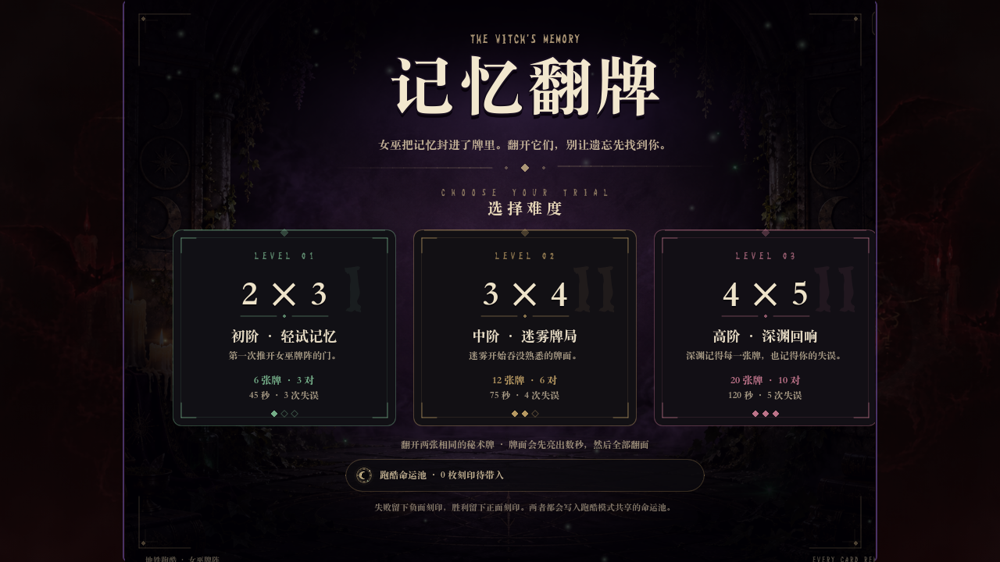

# 04 · 单窗口嵌套与《记忆翻牌》接入

> v3.0 的核心变化：长廊和《记忆翻牌》不再分别是两个 Godot 进程，也不再通过 UDP/窗口最小化衔接。翻牌游戏被复制进本工程，用 `SubViewport` 嵌进长廊主场景的同一个窗口里；玩家在大厅自己选难度。



---

## 1. 为什么改

v2.x 的做法：

```text
长廊进程 --UDP--> GameLink --OS.create_process--> 第二个 Godot 进程
```

问题：

- 会启动第二个 Godot 程序，窗口切换/最小化/恢复很突兀；
- UDP + 等待预热有几十毫秒到几秒的延迟；
- 两个窗口的字体、背景、鼠标模式不一致，割裂感强；
- 无法保证“玩家点图片就无缝进入”。

v3.0 的做法：

```text
Main (一个进程/一个窗口)
└─ EmbeddedMemoryLayer
   └─ SubViewport (1024×768)
      └─ MemoryGame (Control)
```

- 翻牌场景在同一个 SceneTree 里；
- 进入/返回只做淡入淡出；
- 鼠标/键盘由 SubViewportContainer 转发；
- 没有 UDP、没有 spawn、没有最小化。

---

## 2. 场景结构

```text
Main (Node3D)
├─ WorldEnvironment
├─ Corridor
├─ BufferZone (z=1260)
├─ EndingZone (z=2512)
├─ Player
├─ HUD
├─ PactLayer (CanvasLayer 120)        ← 女巫契约图
│  └─ PactRoot (全屏 Control, STOP)
│     └─ TextureRect (witch_pact.png)
├─ FadeLayer (CanvasLayer 200)        ← 黑场过渡
│  └─ ColorRect
└─ EmbeddedMemoryLayer (CanvasLayer 100, 点击后创建)
   └─ MemoryRoot
      ├─ ColorRect 深色底
      ├─ TextureRect 契约图暗色边
      ├─ Panel 紫黑细边框
      └─ SubViewportContainer (960×720, stretch)
         └─ SubViewport (1024×768)
            └─ MemoryGame
```

### 尺寸换算

翻牌游戏按 **1024×768** 设计，长廊窗口是 **1280×720**：

```gdscript
var scale := 720.0 / 768.0          # 0.9375
var view_w := 1024.0 * scale         # 960
var view_h := 768.0 * scale          # 720
container.position.x = (1280 - 960) / 2  # 160
```

左右各 160 px 用契约图做暗色边，并加 2 px 紫黑边框，视觉上像一面“女巫之镜”，不是硬拼两个程序。

---

## 3. 状态机

`scripts/main.gd`：

```text
IDLE
 └─玩家进入 z≈1260 的隐形 Area → PACT
      ├─ 冻结移动、隐藏 HUD
      ├─ 动态雾目标 = 0.38
      ├─ 0.9s 压雾
      ├─ 淡出 0.55s → PactRoot 显示
      └─ 点击整张图 → MEMORY
           ├─ 淡出 0.5s
           ├─ 创建 EmbeddedMemoryLayer
           ├─ 隐藏 3D 长廊（Corridor/Player/...）
           ├─ 淡入 0.7s
           └─ 玩家在翻牌大厅自选难度

MEMORY
 ├─ 一局结束（胜/负）→ run_finished
 │   ├─ 立即隐藏 MemoryGame（不显示它自己的结算页）
 │   ├─ 淡出 0.4s → RETURNING
 │   ├─ 释放 MemoryGame / CanvasLayer，显示 3D/HUD
 │   ├─ 雾恢复 0.038，按 success 施加刻印
 │   ├─ 淡入 0.8s → IDLE
 │   └─ 短提示“已回到长廊”
 └─ 中途退出（Esc/×）→ close_requested
     └─ 判失败 → 回廊 + 负面刻印
```

没有 `countdown`、没有叙事、没有第二进程。

---

## 4. 契约图点击

`PactRoot` 是一个全屏 `Control`：

```gdscript
_pact_root.mouse_filter = Control.MOUSE_FILTER_STOP
_pact_root.gui_input.connect(_on_pact_gui_input)
```

同时 `_unhandled_input` 兜底：

- 鼠标左键（PACT 状态）；
- `Enter` / `Space`。

这样即使窗口缩放、Control 被其他节点挡住，点击画面也能进入。

契约图：`res://assets/ui/witch_pact.png`，`STRETCH_KEEP_ASPECT_COVERED` 铺满 1280×720。

---

## 5. 翻牌场景接入 API

复制过来的 `memory_game/scripts/memory_game.gd` 提供：

| 方法/信号 | 用途 |
| --- | --- |
| `set_embedded(true)` | 显示翻牌游戏自己的 ×/Esc 返回入口 |
| `open_from_command({"view":"menu"})` | 打开大厅，玩家自选难度 |
| `open_from_command({"view":"level","level":"3x4"})` | 直接开某档（本工程**不用**） |
| `close_requested(reason)` | 玩家**中途**点 ×/Esc：判失败，长廊回廊并施加负面刻印 |
| `run_finished(result)` | 一局结束（无论胜/负），长廊**自动**回廊并按 success 施加刻印 |

长廊只调用：

```gdscript
_memory_game.set_embedded(true)
_memory_game.close_requested.connect(_on_memory_close_requested)
_memory_game.run_finished.connect(_on_memory_run_finished)
_memory_game.open_from_command({"view": "menu"})
```

**不指定难度**，所以玩家在大厅看到 2×3 / 3×4 / 4×5 三张卡，自己点。

---

## 6. 翻牌输入为什么能工作

- `SubViewportContainer.mouse_filter = STOP`；
- `SubViewport.handle_input_locally = true`；
- `SubViewport.gui_disable_input = false`；
- 容器没有被透明 Control 覆盖；边框 Panel 的 `mouse_filter = IGNORE`。

窗口模式下已验证：

1. 鼠标移到契约图，hover 到 `PactRoot`，点击进入翻牌；
2. 翻牌大厅鼠标 hover 到 `MemoryViewportContainer`，点击 2×3 卡牌，`_level_id` 变为 `2x3`。

无头模式不做 GUI 点击测试（无真实鼠标），但会验证大厅/难度/嵌入结构。

---

## 7. 返回

翻牌游戏内的返回方式：

- 右上角 `×`（`set_embedded(true)` 显示）；
- `Esc`（翻牌自己的 `_unhandled_input`）；
- 宿主 `main.gd` 在 MEMORY 状态也监听 `Esc` 兜底。

一局结束时收到 `run_finished`：

1. `state = RETURNING`；
2. **立即隐藏 MemoryGame**，避免它自己的“TRIAL COMPLETE / TRIAL FAILED”结算页停留；
3. 淡出 0.4s；
4. `queue_free()` 翻牌场景与 CanvasLayer；
5. 恢复 3D、HUD、鼠标捕获；
6. `_set_fog_relief()`：雾回到 0.038；
7. 按 success 施加 ×1.18 / ×0.82 刻印并显示 HUD 刻印条；
8. 淡入回长廊，短提示“试炼完成/失败 · 刻印已生效”。

中途退出（`close_requested`）走同一返回流程；没有 run_finished 时合成失败结果（reason=abandoned），施加负面刻印。

---

## 8. 结果与 buff

`MemoryGame` 在 `_finish_game()` 里：

- 计算 stats；
- 调 `RunBuffs.queue_buff(buff)`（Autoload 在 `project.godot`）；
- `run_finished.emit({success, reason, stats, buff})`。

长廊的 `_on_memory_run_finished()` 保存结果，并**立即触发自动回廊**（隐藏结算页）：

- `success=true` → 疾行 ×1.18/45s；
- `success=false` → 滞步 ×0.82/45s；
- 中途关闭没有 run_finished → 合成 `{success:false, reason:"abandoned"}`，施加负面刻印。

> 翻牌游戏自己写 RunBuffs 是为了它自己的“跑酷命运池”UI；长廊只读取 `run_finished`，两边互不阻塞。

---

## 9. 资源依赖

从 `subway-runner` 复制，必须一起存在：

```text
memory_game/scripts/*.gd
memory_game/art/cards/*.png
memory_game/art/ui/medallion.png
memory_game/memory_game.tscn
output/witch-ui/background-apothecary.png
output/witch-ui/background-forest.png
output/witch-ui/background-library.png
hakidame.TTF
```

漏掉背景/字体不会崩，但翻牌大厅会变黑/字体回退。

---

## 10. 失败模式

| 现象 | 原因 | 处理 |
| --- | --- | --- |
| 打开仍是黑屏 | HUD FadeRect 未清零 | `hud.set_fade_alpha(0)` |
| 契约图不显示 | CanvasLayer 或 Root 隐藏 | 两者都设 visible=true |
| 点图没反应 | 全屏遮罩/焦点 | 用 `_unhandled_input` 兜底；再点一次 |
| 翻牌黑框 | 资源缺失/SubViewport 尺寸 0 | 查 art/background/font，查容器尺寸 |
| 翻牌鼠标不灵 | 容器被透明 Control 盖住 | 边框 mouse_filter=IGNORE |
| 结束后停在结算页 | run_finished 未触发自动返回 | 在 `_on_memory_run_finished()` 里隐藏 MemoryGame 并调用 `_return_from_memory()` |
| 中途无法退出 | Esc 被宿主吃掉/未连信号 | 宿主 MEMORY 状态监听 Esc；连 close_requested |
| 难度固定 | 仍在 `view=level` | 改成 `view=menu` |
| 两个窗口 | 旧 EventBridge 残留 | 删除旧文件，检查 project.godot |

---

## 11. 导出

导出时 `memory_game/`、`output/witch-ui/`、`hakidame.TTF`、`assets/ui/witch_pact.png` 都要进包。没有外部路径配置，不需要 `memory_game_executable`。

---

## 12. 验收

`bash tools/run_tests.sh` 会验证：

- 触发区自动进入 PACT；
- 无 HUD/对白；
- 契约图显示；
- 点击后同进程 `SubViewport` 打开；
- 大厅三档难度、无固定难度；
- 选择 2×3 后 `_level_id` 正确；
- 胜利/失败回到长廊施加刻印；
- 返回后雾恢复。

详见 [05_测试与验收记录.md](05_测试与验收记录.md)。
