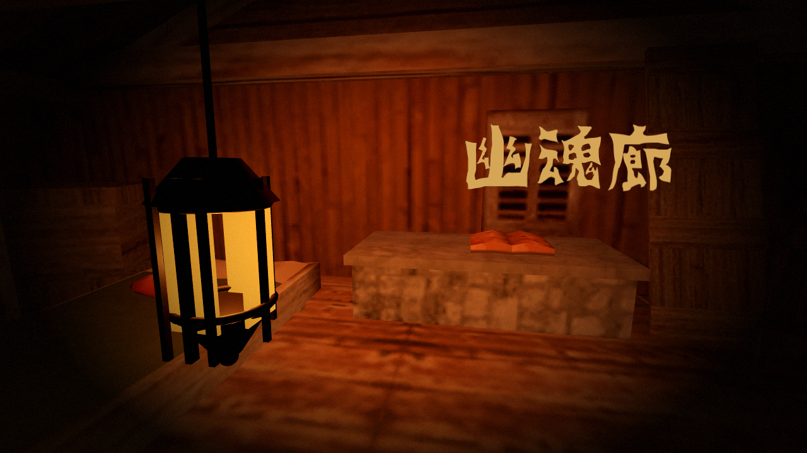

# HELLTOWN · 主界面（独立工程）

这是**只做主界面**的独立 Godot 工程，没有加载、复制或修改任何游戏本体场景。

- 场景：Helltown 鬼屋室内，参考 `docs/reference.jpg` 的第一人称构图（左前景提灯、木质房间、暖色旧光）。
- 音乐：`bad day-01.wav` 循环播放。
- 交互：**点击画面任意位置**（或 Enter / Space）触发 `start_requested` 信号。
- 标题：**幽魂廊**，使用 **hakidame.TTF**；**暖金**（不是纯白），放在画面**右上角**，字号保持 108；已去掉阴影/幽灵副本，只保留非常轻微的摇晃。
- 接口：默认没有接入游戏本体；设置 `Menu` 根节点的 `game_scene_path` 后，点击才会真正切换场景。



> 标题文字只是暂定。`Menu` 根节点的 `Title Text` 可以改，或调用 `set_title("新名字")`；字体与位置接口见下方说明。

## 运行

项目位置：

```text
/Users/chenzhengxin/地铁跑酷/main_menu
```

### 方式 1：双击启动

在 Finder 打开 `main_menu` 文件夹，双击 **`打开主界面.command`**。

### 方式 2：命令行

```bash
"$HOME/Downloads/Godot.app/Contents/MacOS/Godot" --path "$HOME/地铁跑酷/main_menu"
```

或：

```bash
bash "$HOME/地铁跑酷/main_menu/tools/run_menu.sh"
```

### 方式 3：Godot Project Manager

打开 Godot → **Import** → 选择：

```text
/Users/chenzhengxin/地铁跑酷/main_menu/project.godot
```

→ 打开后按 **F5**。主场景是 `scenes/menu.tscn`。

## 操作

| 输入 | 行为 |
| --- | --- |
| 鼠标左键任意位置 | 触发 `start_requested`；配置了游戏路径则淡出进入游戏 |
| Enter / Space | 同左键 |
| `game_scene_path` 为空 | 仅发出信号 + 黑场呼吸，不离开主界面（未接入游戏本体） |

## 文件

```text
main_menu/
├─ project.godot
├─ scenes/menu.tscn              # 主界面场景
├─ scenes/lantern.tscn           # 左前景旧提灯
├─ scripts/menu.gd               # 点击 / 音乐循环 / start_requested / game_scene_path
├─ scripts/lantern.gd            # 提灯摇摆 + 火光闪烁
├─ shaders/menu_vignette.gdshader
├─ assets/model/                 # zip 里的 OBJ + MTL + textures
├─ audio/bad_day.wav
├─ tests/test_menu.gd/.tscn      # 18 项自检
├─ tools/capture_menu.gd         # 重新生成 docs/menu_preview.png
└─ docs/
   ├─ INTEGRATION.md             # 与游戏本体嵌套的步骤
   ├─ reference.jpg              # 用户提供的参考照片
   └─ menu_preview.png
```

## 自检

```bash
"$HOME/Downloads/Godot.app/Contents/MacOS/Godot" --headless \
  --path "$HOME/地铁跑酷/main_menu" res://tests/test_menu.tscn
```

当前 **18 项全部通过**：模型/材质面、相机、提灯、WAV、音乐播放、循环模式、全屏点击层、标题《幽魂廊》三字完整、hakidame 字体、右上角定位、无阴影层、轻微摇晃、`set_title`、`start_requested`、默认未接入游戏本体。

## 标题修改接口

- 编辑器：选中 `Menu` 根节点，改检查器里的 **Title Text**（默认 `幽魂廊`）。
- 代码：

```gdscript
$Menu.set_title("新名字")
```

- 字体：`assets/fonts/hakidame.TTF`，字号 108；`title_font_path` 可替换字体。
- 位置：`TitleRoot` 锚定右上角，`MainRow` 右对齐；想改位置调整 `TitleRoot` 的 anchor/offset。
- 当前“幽魂廊”三个字 hakidame 都有，不需要补字；如果以后换字体缺字，可把字加入 `TITLE_FALLBACK_CHARS`。

## 说明

- 模型来自用户提供的 `helltown-house-hauntedinside 2.zip`（Sketchfab: Helltown - House Haunted(Inside), Zorg_Sinister）；原始 zip 不放进工程，只放导入所需 OBJ/MTL/贴图。
- 字体来源：最初提供的 `hakidame.TTF`，当前标题“幽魂廊”三字都有字形。
- 场景没有 Autoload；集成时按 [docs/INTEGRATION.md](docs/INTEGRATION.md) 操作。
- 除标题“幽魂廊”外，主界面不显示按钮、提示或其他文字。
