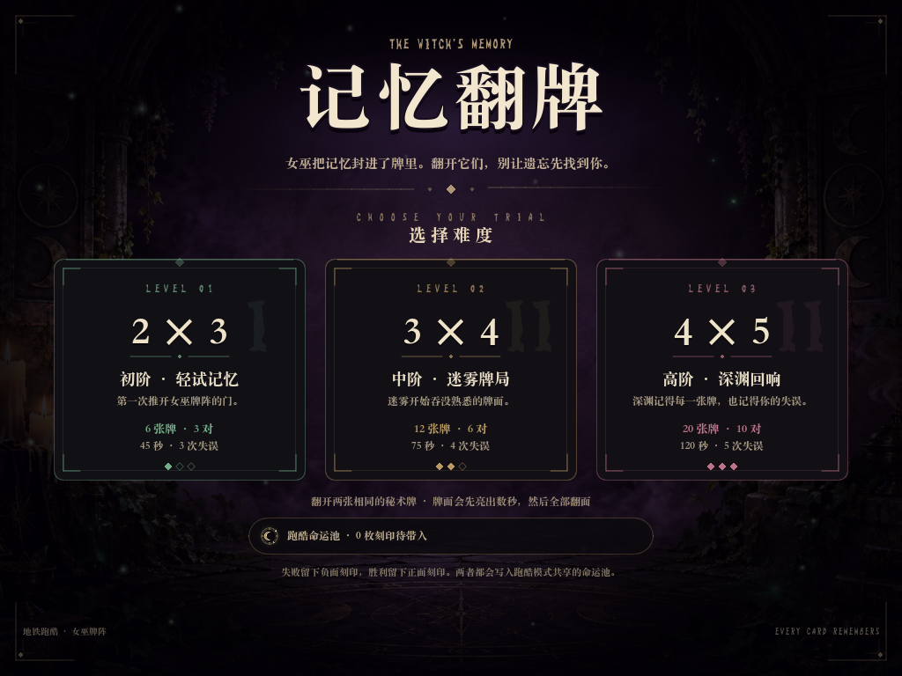
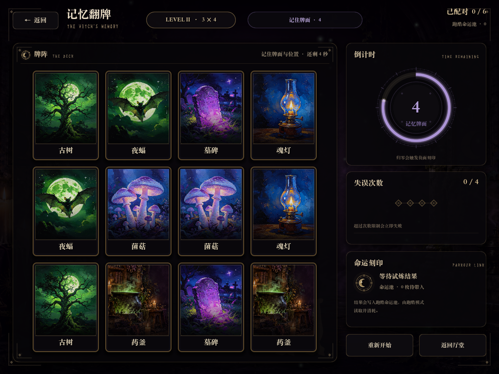
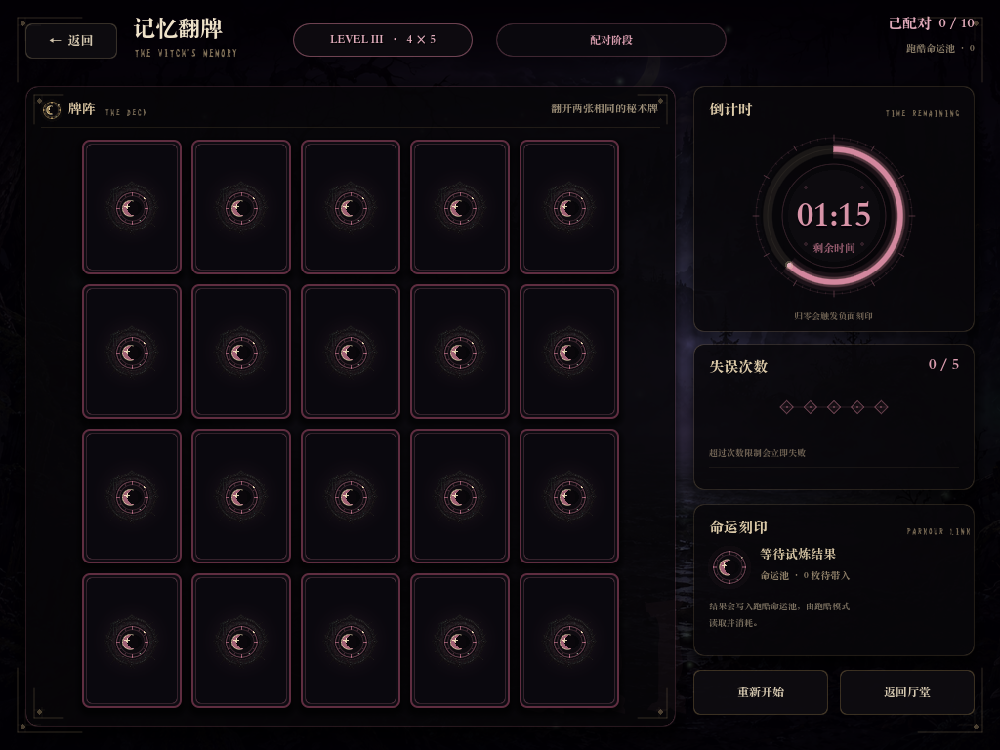
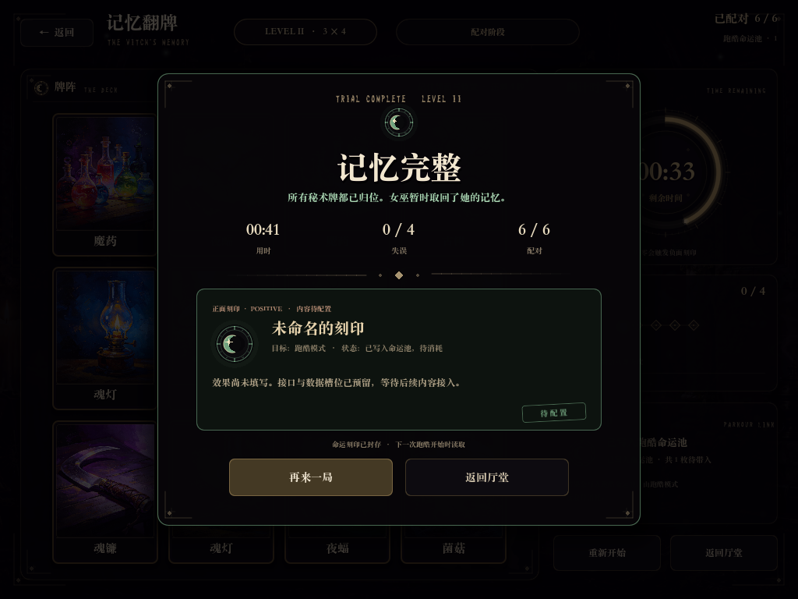
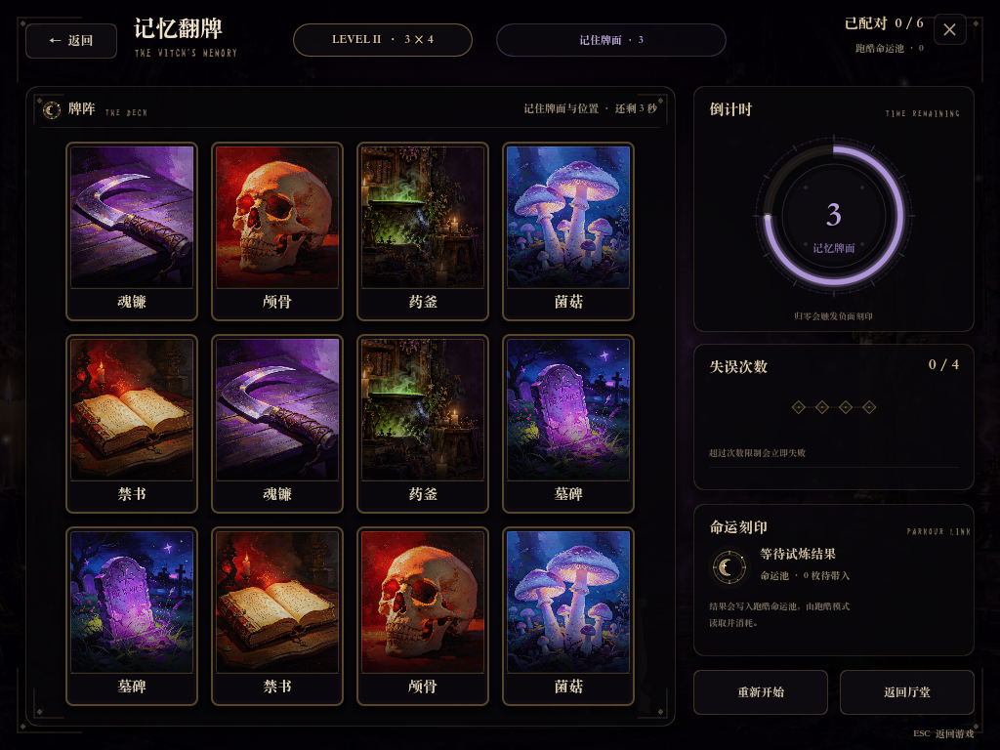

# 记忆翻牌 · 女巫牌阵

用 **Godot 4.7 + GDScript** 完成的记忆配对游戏，放在独立文件夹 `memory_game/` 里。视觉沿用项目中已有的女巫牌桌素材、字体与紫绿配色，做成一个可以直接玩的试炼，并通过共享的 **跑酷命运池** 与后续跑酷玩法相连。

打开方式也改成了**指令触发**：项目新增 `GameLink` Autoload，另一个游戏调用它或发送本地 UDP 指令，就能在已预热的进程里快速显示记忆翻牌，不再依赖双击 `.command` 启动脚本。



## 启动方式

> 按你的要求，根目录不再提供手动双击的 `.command` 启动脚本。记忆翻牌由 `GameLink` 接收另一个游戏的指令打开；开发时仍然直接在 Godot 里按 F5 预览。

**开发预览：**

1. 打开 Godot 4.7 Project Manager。
2. Import → 选择 **`/Users/chenzhengxin/地铁跑酷/project.godot`**。
3. 按 **F5**。主场景当前仍是记忆翻牌，因此会直接进入大厅；`GameLink` 同时开始监听触发指令。

命令行等价启动（这台机器的 Godot 不在 PATH，所以写完整路径）：

```bash
"$HOME/Downloads/Godot.app/Contents/MacOS/Godot" --path "$HOME/地铁跑酷"
```

进入游戏后：选择一张难度卡 → 先记住所有亮出的牌 → 牌面翻面后开始配对。

想直接看“另一个游戏触发”的效果：在 Godot 里单独运行 **`memory_game/integration/trigger_demo.tscn`**（F6），点击按钮发送 GameLink 指令；记忆翻牌会覆盖上来，按 Esc 或右上角 × 回到测试台。

> 项目根目录原有的 `main.tscn`、`scenes/`、`游戏/` 等文件没有改动；如果之后要把跑酷设为当前主场景，只需修改 `project.godot` 的 `run/main_scene`，记忆翻牌由指令打开即可。

## 另一个游戏怎么打开它（GameLink）

详细协议与实测数据见 **[integration/INTERGAME_TRIGGER.md](integration/INTERGAME_TRIGGER.md)**。入口是 Autoload `GameLink`（[scripts/game_link.gd](scripts/game_link.gd)）。

**同一个 Godot 进程（推荐，最快）：**

```gdscript
# 打开大厅
GameLink.send_command("open_memory_game", {"view": "menu"})

# 直接进入 3×4
GameLink.send_command("open_memory_game", {"view": "level", "level": "3x4"})

# 关闭，宿主游戏从暂停处继续
GameLink.send_command("close_memory_game", {"reason": "parkour_resume"})
```

**独立进程 / 另一个引擎（本地 UDP）：**

```json
{"command":"open_memory_game","view":"level","level":"3x4"}
```

发送到 `127.0.0.1:45910`。如果记忆翻牌进程还没运行，先由另一个游戏在启动时拉一个预热进程（保持最小化）：

```bash
GODOT_BIN --path "/Users/chenzhengxin/地铁跑酷" -- --warm
```

收到指令后恢复窗口并显示，关闭后再次最小化，避免每次触发都冷启动。打开完成后会收到 JSON 响应。

- 右上角 **×** 和 **ESC** 可以关闭并回到发出指令的游戏；
- 打开时会暂停宿主场景树，关闭时恢复到打开前的暂停状态；
- 实测：同进程打开大厅约 **4 ms**，首次直接开 3×4（构建 12 张牌）约 **65–85 ms**；UDP 处理约 **0.3–2 ms**，另加一帧渲染。冷启动 Godot 进程仍需 1 秒以上，所以追求快速响应请用同进程或 `--warm` 常驻。

## 玩法与已实现内容

- **大厅**：游戏标题、女巫主题副标题、三档难度卡、跑酷命运池状态。
- **三档难度**（点击卡片进入各自牌局，背景与强调色不同）：
  - `2 × 3`：6 张牌 / 3 对 / 45 秒 / 3 次失误
  - `3 × 4`：12 张牌 / 6 对 / 75 秒 / 4 次失误
  - `4 × 5`：20 张牌 / 10 对 / 120 秒 / 5 次失误
- **记忆阶段**：开局所有牌面朝上，3–5 秒后依次翻面；记忆时间与倒计时都从配置读取。
- **配对**：翻两张相同的牌 → 牌面收缩消散，留下空位；不同则抖动、闪红、翻回，并累计失误。
- **倒计时**：右侧圆形进度环 + 数字；最后 10 秒转为红色并脉冲。归零立即失败。
- **失误上限**：菱形烛火指示；超过上限立即失败。
- **结算**：失败生成负面刻印；成功生成正面刻印。两类 Buff 都只搭好框架，内容池为空，等待后续填充。
- **跑酷接口**：Buff 通过 `RunBuffs` Autoload 以及 `integration/parkour_buff_receiver.gd` 接入，详见 [integration/BUFF_INTERFACE.md](integration/BUFF_INTERFACE.md)。
- **游戏间触发**：`GameLink` 预热场景并接收同进程指令或本地 UDP 指令；嵌入模式右上角有 ×、按 ESC 返回。






更多截图在 [`screenshots/`](screenshots/)。

## 难度与倒计时怎么改

所有数值集中在 [`scripts/game_config.gd`](scripts/game_config.gd) 的 `LEVELS` 里：

```gdscript
"3x4": {
	"time_limit": 75.0,     # ← 直接改这里就能改倒计时
	"max_mistakes": 4,      # ← 失误上限
	"preview_time": 4.0,    # ← 开局记忆时长
	"columns": 4,           # 牌阵列数
	"rows": 3,              # 牌阵行数
	"pairs": 6,
	...
}
```

- 界面显示写成 `行 × 列`（例如 3 × 4），实际牌阵为了适配 1024×768 横屏，用的是 4 列 × 3 行。
- 卡片尺寸、间距、强调色也在同一份配置里。
- 卡池是 `CARD_POOL`，每局会随机抽取 `pairs` 个不同图案，每个图案两张；4×5 需要 10 对，会从 11 种设计中随机取 10 种。要加新卡面，把图片放进 `art/cards/` 并在 `CARD_POOL` 增加一条即可。
- 卡池目前有 11 种：原有 9 张女巫卡面 + 从现有背景中裁出的“翠焰药釜”“囚月之窗”两张，风格与原来保持一致。

## 文件结构

```text
memory_game/
├─ memory_game.tscn                 # 主场景（脚本生成 UI）
├─ README.md
├─ scripts/
│  ├─ memory_game.gd                # 大厅 / 牌局 / 结算 / 流程控制 / 嵌入返回
│  ├─ game_link.gd                  # GameLink Autoload：预热、overlay、UDP 触发
│  ├─ game_config.gd                # 难度、倒计时、卡池配置
│  ├─ memory_card.gd                # 单张牌：翻面、悬停、配对消散、失误抖动
│  ├─ memory_timer_ring.gd          # 圆形倒计时
│  ├─ memory_mistake_track.gd       # 失误菱形指示
│  ├─ memory_difficulty_card.gd     # 大厅难度卡
│  ├─ memory_sigil.gd               # 月亮徽记（纯矢量绘制）
│  ├─ memory_ornament_line.gd       # 分隔线装饰
│  ├─ memory_screen_frame.gd        # 屏幕四角装饰
│  ├─ buff_catalog.gd               # 正面/负面 Buff 内容池（目前为空）
│  └─ run_buffs.gd                  # RunBuffs Autoload：跨游戏命运池
├─ integration/
│  ├─ parkour_buff_receiver.gd      # 跑酷端 Buff 接收器示例
│  ├─ trigger_demo.gd / .tscn       # 模拟另一个游戏的触发测试台
│  ├─ BUFF_INTERFACE.md             # Buff 数据协议
│  └─ INTERGAME_TRIGGER.md          # GameLink 触发协议 / UDP / 预热 / 延迟
├─ art/
│  ├─ cards/                        # 11 张卡面
│  └─ ui/medallion.png              # 卡背月纹底图
├─ screenshots/                     # 自动截取的实际画面
└─ tests/
   ├─ smoke_test.gd                 # 玩法冒烟测试
   ├─ smoke_test.tscn
   ├─ intergame_trigger_test.gd     # 游戏间触发测试
   └─ intergame_trigger_test.tscn
```

## 质量检查

已经用真实渲染 + 真实鼠标命中测试跑通完整流程。冒烟测试覆盖：

1. 发牌完成、所有牌面翻到背面；
2. 两张相同牌配对成功并消失；
3. 两张不同牌配对失败、翻回背面、失误 +1；
4. 失误超限 → 失败结算 → 负面 Buff 写入 `RunBuffs`；
5. 全部配对 → 胜利结算 → 正面 Buff 写入 `RunBuffs`；
6. `RunBuffs.consume_pending()` 可被跑酷端消费；
7. 倒计时归零 → 失败结算 → 负面 Buff 写入。
8. GameLink 预热、同进程指令打开、宿主暂停/恢复、嵌入模式返回；
9. UDP 指令打开、JSON 响应；暂停期间记忆翻牌倒计时继续推进；
10. 跨进程试炼结果回传：一局结束时向最近 UDP 调用方推送 `memory_run_finished` 事件（胜/负/统计/刻印）。

```bash
GODOT="$HOME/Downloads/Godot.app/Contents/MacOS/Godot"
PROJECT="$HOME/地铁跑酷"

# 玩法冒烟测试（带真实鼠标命中；推荐）
"$GODOT" --path "$PROJECT" --audio-driver Dummy \
  --rendering-method gl_compatibility res://memory_game/tests/smoke_test.tscn

# 游戏间触发测试：预热 / 同进程指令 / 宿主暂停 / Esc 返回 / UDP 指令 / JSON 响应
"$GODOT" --headless --path "$PROJECT" --audio-driver Dummy \
  res://memory_game/tests/intergame_trigger_test.tscn

# 跨进程试炼结果回传测试（memory_run_finished UDP 事件）
"$GODOT" --headless --path "$PROJECT" --audio-driver Dummy \
  res://memory_game/tests/result_echo_test.tscn

# 纯无头玩法测试（headless 不派发 GUI 指针事件，测试会自动退回直接调用）
"$GODOT" --headless --path "$PROJECT" --audio-driver Dummy \
  res://memory_game/tests/smoke_test.tscn
```

也可以直接截图查看各个画面（保存到 `/tmp/memory_*.png`）：

```bash
"$HOME/Downloads/Godot.app/Contents/MacOS/Godot" --path "$HOME/地铁跑酷" -- --capture=menu
# 还可以把 menu 换成 preview / game2x3 / game3x4 / game4x5 / success / fail
```

## 打不开 / 触发失败时先看这里

| 现象 | 原因 / 解决 |
| --- | --- |
| 想双击一个文件就启动 | 按你的要求已移除 `.command` 启动脚本。开发时在 Godot 编辑器打开项目按 F5；正式运行时由另一个游戏通过 GameLink 发指令 |
| 终端里 `godot: command not found` | Godot 不在 PATH。用完整路径 `/Users/chenzhengxin/Downloads/Godot.app/Contents/MacOS/Godot`，或直接在 Godot 编辑器里按 F5 |
| 双击 `project.godot` 只是打开了文本 | 不要双击文件；从 Godot Project Manager 里 Import 整个项目 |
| 直接双击 `memory_game.tscn` 报找不到 res:// 资源 | 不要脱离项目单独打开场景。先打开整个项目，再在编辑器里运行 |
| 另一个游戏调用 GameLink 没反应 | 确认 `GameLink` Autoload 存在，并且调用方与记忆翻牌在同一个 Godot 进程；跨进程请用 UDP 且确认进程已运行 |
| UDP 没有响应 | 先发 `{"command":"ping"}` 测试；查看日志里 `[GameLink] listening for trigger: udp://127.0.0.1:45910`；端口被占用时用 `MEMORY_TRIGGER_PORT` 换端口 |
| 触发打开很慢 | 不要每次冷启动 Godot。同进程直接用 `GameLink`；独立进程请用 `--warm` 常驻预热模式 |
| 界面空白/图片丢失 | 用 Godot 编辑器打开根目录项目，让它自动重新导入 `memory_game/art/` 下的图片，再按 F5 |

## 说明与边界

- Buff 内容**故意为空**：成功/失败都会生成带完整 schema 的刻印，但 `title`、`description`、`effects` 留空，UI 用“未命名的刻印 / 待配置”占位。填充入口只有 `scripts/buff_catalog.gd`。
- 记忆翻牌本身**不会应用** Buff，只负责写入跑酷命运池；跑酷端负责消费和应用。两边通过 `target: "parkour"` 与 `RunBuffs` 解耦。
- 音效暂未加入（项目里没有现成音频素材），后续可在 `memory_card.gd` / 主流程的翻牌、配对、结算节点接 AudioStreamPlayer。
- 画面以 1024×768 设计；项目当前窗口与拉伸设置未改。
- 根目录不再提供 `.command` 启动脚本；快速的打开/关闭由 `GameLink` 负责，另一个游戏无需拼命令行。
- 同进程触发时，记忆翻牌在 `CanvasLayer(layer=100)` overlay 中显示，不会销毁宿主场景；关闭后宿主从暂停处继续。
